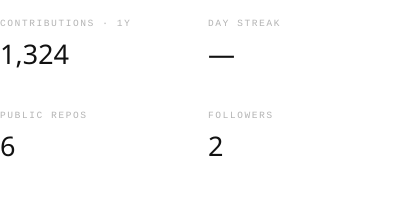
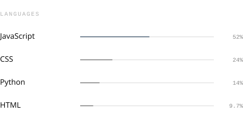
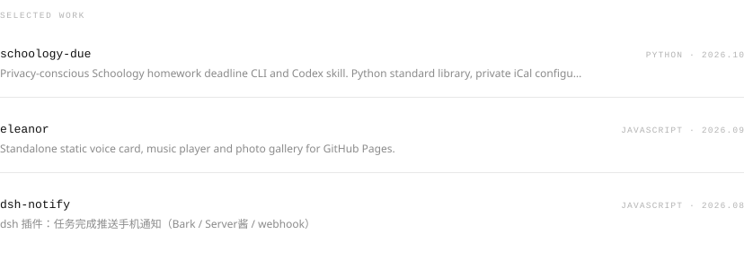
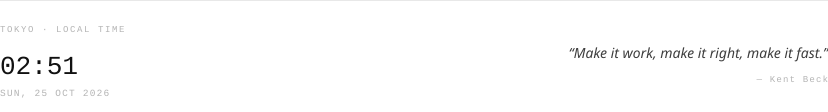

<!-- rendered from config/profile.json by scripts/build.mjs, refreshed by Actions -->
<picture>
  <source media="(prefers-color-scheme: dark)" srcset="assets/hero-dark.svg">
  
</picture>

<picture>
  <source media="(prefers-color-scheme: dark)" srcset="assets/figures-dark.svg">
  
</picture> <picture>
  <source media="(prefers-color-scheme: dark)" srcset="assets/languages-dark.svg">
  
</picture>

<picture>
  <source media="(prefers-color-scheme: dark)" srcset="assets/work-dark.svg">
  
</picture>

<picture>
  <source media="(prefers-color-scheme: dark)" srcset="assets/now-dark.svg">
  
</picture>

[github](https://github.com/NkhszkQAQ) · [repositories](https://github.com/NkhszkQAQ?tab=repositories) · [source](https://github.com/NkhszkQAQ/NkhszkQAQ) · 
