<!-- generated by scripts/build.mjs from config/ — edit those, not this file -->

<picture>
  <source media="(prefers-color-scheme: dark)" srcset="assets/hero-dark.svg">
  
</picture>

<a href="https://github.com/NkhszkQAQ">
<picture>
  <source media="(prefers-color-scheme: dark)" srcset="assets/activity-dark.svg">
  
</picture>
</a>

<a href="https://github.com/NkhszkQAQ?tab=repositories">
<picture>
  <source media="(prefers-color-scheme: dark)" srcset="assets/work-dark.svg">
  
</picture>
</a>

<a href="https://github.com/NkhszkQAQ/schoology-due">schoology-due</a> &nbsp;·&nbsp; <a href="https://github.com/NkhszkQAQ/dsh-notify">dsh-notify</a> &nbsp;·&nbsp; <a href="https://github.com/NkhszkQAQ/astrbot_plugin_dllm">astrbot_plugin_dllm</a>

<picture>
  <source media="(prefers-color-scheme: dark)" srcset="assets/quote-dark.svg">
  
</picture>

<a href="https://github.com/NkhszkQAQ">github</a> &nbsp;·&nbsp; <a href="https://github.com/NkhszkQAQ?tab=repositories">repositories</a> &nbsp;·&nbsp; 

